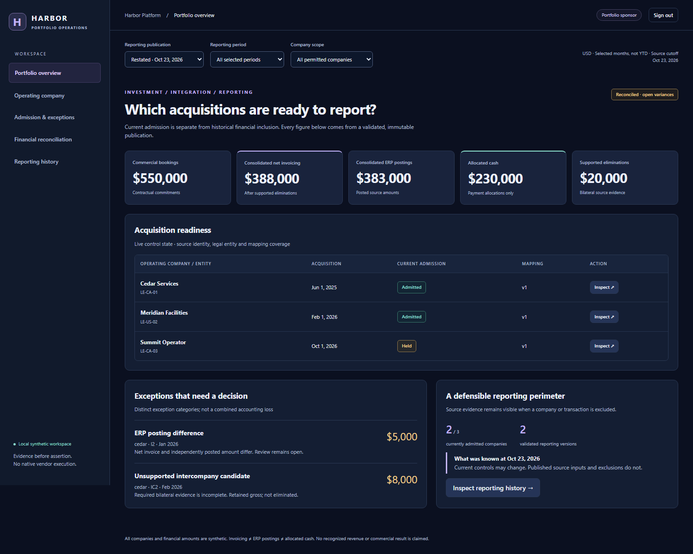
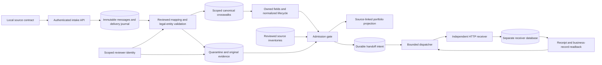

# Enterprise Acquisition Onboarding

**An imported acquisition is not a report-ready business.**

A parent platform needs to attach acquired companies to shared infrastructure while preserving local customer IDs, operating definitions and legal entities. This executable control layer admits a company only after reviewed mappings, exact source coverage and source-to-projection reconciliation succeed. An authorized reviewer can resolve identity exceptions and resnapshot mappings; a durable outbox delivers an admitted handoff only after checking its current authority. Source-linked financial reports then reconcile invoices, ERP postings, allocated cash and supported intercompany eliminations against an independent Python oracle.

Three fictional companies use different local CRM, operations and finance contracts. All data is synthetic. HubSpot, Salesforce, LMN, Aspire, QuickBooks and NetSuite names identify limited representative contracts; **no native vendor API, client system or cloud resource is used**.

**Two deliberately separate scenarios:** the default selected-month correctness fixture preserves its USD $550,000 bookings and verified exceptions. The optional [annual operating scenario](docs/annual-scenario.md) generates twelve months for the same three companies, with assumed gross billing profiles of $8.4M, $12.6M and $6.3M. Neither scenario claims recognized annual revenue. Acquisition-effective exclusions and held companies prevent unsupported portfolio reporting.

## Quick start with Docker

With Docker Engine 28+ and Compose V2, run from this repository:

```text
docker compose up --build
```

Wait for `ready`, then open **http://127.0.0.1:8592/console**. Retrieve your fresh private sponsor login in a separate terminal:

```text
docker compose exec demo python -m onboarding.portable credentials --user sponsor
```

Startup runs real PostgreSQL, independent HTTP contracts and validated original/restated dbt publications. The console is host-loopback only; databases and internal APIs are not published. Use `docker compose down --volumes --remove-orphans` to remove this disposable demo. Each subsequent startup creates fresh data and credentials. [Guided walkthrough](docs/portable-demo.md) · [Executed packaging evidence and screenshots](docs/evidence/portable/README.md).

## Inspect the operations console

The authenticated local console lets sponsors inspect the portfolio, company leaders see only their company, and a scoped reviewer make actual identity/mapping decisions. Financial drilldowns read validated publications, never working dbt tables. Current admission and historical financial inclusion remain visibly separate.



[Run and inspect the console](docs/operations-console.md) · [Browser evidence and screenshots](docs/evidence/pass4/README.md)

## Follow the admission decision

| Synthetic company | Source structures | Demonstrated result |
|---|---|---|
| Cedar Services, LE-CA-01 | HubSpot-style camel-case CRM, LMN-style operations, QuickBooks-style account control | Clean source intake and reviewed crosswalks can pass admission |
| Meridian Facilities, LE-US-02 | Salesforce-style CRM, Aspire-style operations, NetSuite-style account control | Different local states normalize without changing their original records |
| Summit Operator, LE-CA-03 | Legacy CRM, operations and finance snapshots | Held identity is explicitly reviewed; a wrong-entity event stays invalid; corrected source facts and mapping resnapshot permit admission |

All companies deliberately reuse local ID `100` and the same customer trade name. Scoped, explicitly reviewed crosswalks keep their customer accounts distinct. Name similarity never creates a link or merges finance accounts.

The admission projection includes only currently admitted companies and retains each held company's exceptions, local definitions and source lineage. Its metric is a **count of scoped customer accounts**, not deduplicated global parties, financial consolidation, revenue or cash. CRM Won maps to a qualified commercial state and proves none of those financial outcomes. Pass 3 supplies separate source-linked financial reports under an explicit reporting policy.

## Architecture



PostgreSQL owns registry, mapping versions, crosswalks, raw messages, normalized fields, exceptions and admission observations. Company-scoped transaction locks serialize intake and admission. Duplicate delivery preserves the original event and creates no additional business record. A repeated event ID with different content is retained as a conflict and blocks readiness.

The gate compares exact expected source IDs, revisions and raw content hashes, validates active mapping versions, and checks normalized fields and provenance against source records. Equal row counts and a persisted ready flag are insufficient. New source facts invalidate prior readiness until coverage is reviewed again. Missing source coverage remains unknown rather than becoming zero.

[Admission contract](docs/admission-contract.md) · [Review and execution controls](docs/governed-execution.md) · [Financial reporting](docs/financial-reporting.md) · [Pass ledger](docs/progress.md)

## Run the complete local slice

Use Python 3.12 and PostgreSQL 17 binaries, including `initdb` and `pg_ctl`. No vendor credentials are required.

```text
python -m venv .venv
# Activate .venv using your operating system's command.
python -m pip install -r requirements.lock
python -m pip install --no-deps --no-build-isolation -e .
# Set PG_BIN to the PostgreSQL bin directory, or put the binaries on PATH.
python -m onboarding.demo --workspace .local/demo-01 --output .local/demo-01.json
python -m onboarding.pass2_demo --workspace .local/pass2-01 --output .local/pass2-01.json
python -m onboarding.financial_demo --workspace .local/finance-01 --output .local/finance-01.json
```

Each command starts isolated PostgreSQL databases and real loopback HTTP processes, sends actual requests, writes a source-linked JSON summary and stops its resources. The second demonstrates explicit review, mapping version 2, separate business facts, a receiver commit followed by a lost response, independent readback and duplicate prevention. It requires a fresh workspace and output path. Local credentials are generated privately, never printed or committed. Never use a client or production database.

```text
python scripts/verify.py --workspace .local/verify-01 --output .local/evidence-01
python scripts/check_repository.py
```

On Windows, set `PG_BIN` with `$env:PG_BIN='C:/path/to/PostgreSQL/bin'`. On macOS/Linux, use `export PG_BIN=/path/to/postgresql/bin`. Run as an ordinary local user; PostgreSQL `initdb` rejects root. CI instead supplies a disposable PostgreSQL service and creates fresh random databases and restricted roles.

## Executed evidence and boundaries

The original [Pass 1 acceptance](docs/evidence/pass1/README.md) preserves its **23 passing tests** and standalone PostgreSQL/HTTP demonstration byte for byte. [Pass 2 acceptance](docs/evidence/pass2/README.md) records **39 passing tests**, governed review, resnapshot and independently receipted execution. Each record pins its actual implementation revision and source hashes. GitHub CI checks the archived artifacts and reruns local acceptance without vendor credentials.

Pass 1 includes identity ambiguity, legal-entity rejection, source ownership, lifecycle normalization, replay, concurrent duplicate delivery, source coverage, mapping versions, immutable evidence and reconciliation-based admission. The source identity can ingest only its own company/system; the sponsor identity is read-only; a separate controller identity may request the computed admission check. The ingestion database role cannot change registry identity, mappings, baselines or crosswalks.

Pass 2 uses separate source, controller and reviewer API identities, plus a separate PostgreSQL receiver database and login. Rejected review decisions, original quarantine and source versions remain immutable. Revised mappings require exact reviewed coverage and rebuild normalized fields; stale decisions fail closed. A wrong legal entity requires legitimate corrected source intake, not identity approval.

The outbox freezes content and idempotency identity, persists at most three dispatch attempts, and verifies both the receiver receipt and its separately queried business record. A genuine worker termination is also tested. Unknown readback is not evidence of absence. Recovering a historical commit does not authorize a new write. These finite controls do not establish universal exactly-once execution or production reliability.

**Opportunity won, work-order completion and finance-account verification are distinct facts. None establishes revenue, invoice settlement or cash.** The receiver creates an internal synthetic onboarding handoff, not a vendor job or financial transaction. Pass 3 adds actual financial source contracts and reconciliation; the handoff itself supplies none of those financial facts.

Initial fixture mappings are installed by the trusted local harness. Subsequent decisions use a separately authenticated synthetic reviewer, not a claimed independent human approval. The controller cannot override failed checks. Tokens, role separation and loopback HTTP are demonstration controls, not production SSO/TLS, per-brand database RLS or protection against a compromised host administrator. Native connectors, CDC continuity, statutory consolidation and production SSO/RLS remain outside this delivery.

## Financial reporting and restatement

[Pass 3](docs/financial-reporting.md) runs nine real PostgreSQL dbt models and an independently calculated Python oracle. The synthetic selected-month scenario produces **USD 368,000 consolidated net invoicing, USD 363,000 ERP postings and USD 230,000 allocated cash**. A USD 5,000 posting discrepancy and an unsupported USD 8,000 intercompany candidate stay open. USD 20,000 is eliminated only with exact bilateral document evidence.

A late January source correction yields a new reporting version with **USD 388,000 consolidated net invoicing and USD 383,000 postings**; cash remains unchanged. The original report and source revisions survive. A deliberately unbalanced candidate fails real dbt data tests and cannot publish. Reports use source-observation cutoffs plus captured admission state; no recognized revenue or commercial outcome is claimed.

**Preserved Pass 3 acceptance: 50 passing tests, both validated dbt builds and all three standalone demos.** [Pass 3 execution, oracle comparisons and rejected evidence](docs/evidence/pass3/run02/README.md). The same financial publications now back the role-scoped browser console. Browsing, changing reporting versions and reviewing admission do not dispatch business-system writes.

## Open the local application

After the pinned setup above:

```text
python -m onboarding.console_demo --workspace .local/console-01 --serve
```

The command prepares real source/financial records and prints a loopback URL plus the generated private credentials-file path. Sign in with the corresponding sponsor, company-leader or reviewer credentials; stop with Ctrl+C to clean up. No shared password or credential is embedded in the UI. Chromium is required only for automated browser acceptance; follow the [workspace-path installation instructions](docs/operations-console.md).

**Pass 5 acceptance: 62 regression tests, 53 real-browser checks, seven route-verified screenshots and seven accessibility scans with no violations or unresolved checks.** The [independent adversarial acceptance record](docs/evidence/pass5/README.md) documents the tested boundaries, direct HTTP/database negatives, separate financial recalculation and one corrected browser-evidence synchronization defect. Earlier evidence remains byte-for-byte unchanged; the [Pass 4 record](docs/evidence/pass4/README.md) remains historical.

**Decision: ready for the stated local synthetic scope.** No material authorization, financial correctness or replay-safety failure was demonstrated. Production SSO/TLS/RLS, native connectors, statutory accounting and universal exactly-once execution remain outside the demonstrated scope. This is an independent AI-led assessment, not independent human security certification. The original implementation is merged; the portable extension is submitted separately for review. No deployment is authorized.
