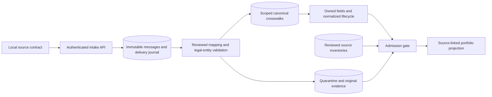

# Enterprise Acquisition Onboarding

**An imported acquisition is not a report-ready business.**

A parent platform needs to attach acquired companies to shared infrastructure while preserving local customer IDs, operating definitions and legal entities. This executable foundation admits a company only after reviewed mappings, exact source coverage and source-to-projection reconciliation succeed. Ambiguous identities remain held for review.

Three fictional companies use different local CRM, operations and finance contracts. All data is synthetic. HubSpot, Salesforce, LMN, Aspire, QuickBooks and NetSuite names identify limited representative contracts; **no native vendor API, client system or cloud resource is used**.

## Follow the admission decision

| Synthetic company | Source structures | Demonstrated result |
|---|---|---|
| Cedar Services, LE-CA-01 | HubSpot-style camel-case CRM, LMN-style operations, QuickBooks-style account control | Clean source intake and reviewed crosswalks can pass admission |
| Meridian Facilities, LE-US-02 | Salesforce-style CRM, Aspire-style operations, NetSuite-style account control | Different local states normalize without changing their original records |
| Summit Operator, LE-CA-03 | Legacy CRM, operations and finance snapshots | Two plausible customer identities and a wrong-entity delivery block admission |

All companies deliberately reuse local ID `100` and the same customer trade name. Scoped, explicitly reviewed crosswalks keep their customer accounts distinct. Name similarity never creates a link or merges finance accounts.

The consolidated projection includes only currently admitted companies and retains each held company's exceptions, local definitions and source lineage. Its metric is a **count of scoped customer accounts**, not deduplicated global parties, financial consolidation, revenue or cash. CRM Won maps to a qualified commercial state and proves none of those financial outcomes.

## Architecture



PostgreSQL owns registry, mapping versions, crosswalks, raw messages, normalized fields, exceptions and admission observations. Company-scoped transaction locks serialize intake and admission. Duplicate delivery preserves the original event and creates no additional business record. A repeated event ID with different content is retained as a conflict and blocks readiness.

The gate compares exact expected source IDs, revisions and raw content hashes, validates active mapping versions, and checks normalized fields and provenance against source records. Equal row counts and a persisted ready flag are insufficient. New source facts invalidate prior readiness until coverage is reviewed again. Missing source coverage remains unknown rather than becoming zero.

[Admission contract and trust boundary](docs/admission-contract.md) · [Pass ledger and next scope](docs/progress.md)

## Run the complete local slice

Use Python 3.12 and PostgreSQL 17 binaries, including `initdb` and `pg_ctl`. No vendor credentials are required.

```text
python -m venv .venv
# Activate .venv using your operating system's command.
python -m pip install -r requirements.lock
python -m pip install --no-deps --no-build-isolation -e .
# Set PG_BIN to the PostgreSQL bin directory, or put the binaries on PATH.
python -m onboarding.demo --workspace .local/demo-01 --output .local/demo-01.json
```

The command starts an isolated PostgreSQL cluster and a real loopback FastAPI process, sends actual HTTP requests, evaluates admission, replays a delivery, writes the source-linked JSON summary and stops its resources. It requires a fresh workspace and output path. Local credentials are generated privately, never printed or committed. Never use a client or production database.

```text
python scripts/verify.py --workspace .local/verify-01 --output .local/evidence-01
python scripts/check_repository.py
```

On Windows, set `PG_BIN` with `$env:PG_BIN='C:/path/to/PostgreSQL/bin'`. On macOS/Linux, use `export PG_BIN=/path/to/postgresql/bin`. Run as an ordinary local user; PostgreSQL `initdb` rejects root. CI instead supplies a disposable PostgreSQL service and creates only a fresh random database and restricted application role.

## Pass 1 evidence and boundaries

**23 tests passed with zero failures, errors or skips**, followed by a standalone real HTTP/PostgreSQL demonstration. [Recorded acceptance](docs/evidence/pass1/README.md) includes the exact implementation revision, source hashes and expected-versus-observed outcomes. GitHub CI verifies original evidence and repeats the local acceptance without vendor credentials.

Pass 1 includes identity ambiguity, legal-entity rejection, source ownership, lifecycle normalization, replay, concurrent duplicate delivery, source coverage, mapping versions, immutable evidence and reconciliation-based admission. The source identity can ingest only its own company/system; the sponsor identity is read-only; a separate controller identity may request the computed admission check. The ingestion database role cannot change registry identity, mappings, baselines or crosswalks.

This is a finite local foundation. It does not implement native connectors, downstream job/finance writes, outbox dispatch, lost-acknowledgment receiver recovery, CDC continuity, financial models, statutory consolidation, public authentication, per-brand database RLS or an operator browser. Those are later roadmap passes. Quarantine is intentionally fail-closed: reviewed resolution and mapping migration are not implemented by deleting failures or silently accepting a retry.

The approved mapping and baseline review in this fixture is performed by the trusted synthetic installer, not claimed as independent human approval. The API's separate controller cannot override failed checks. Loopback HTTP tokens are local demonstration controls, not production SSO/TLS or an Internet-facing security certification.
