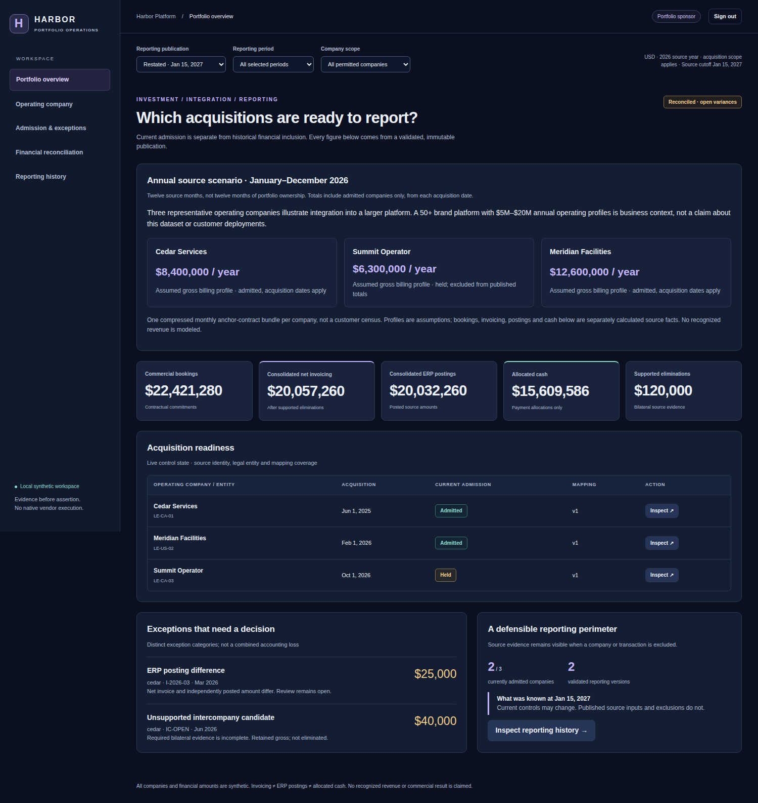

# Annual financial scenario: executed evidence

This is a separate synthetic twelve-month source scenario, not a rescaling of the selected-period correctness fixture. The same three companies, governance, financial SQL/dbt, independent Python oracle and portable security boundary execute unchanged.

## Inspect the executed record

- [Financial events, frozen source inputs, controls, dbt nodes and model comparisons](run01/financial.json).
- [Actual Compose/browser acceptance, source revision, image settings and cleanup](run01/annual.json).
- [Exact artifact inventory and SHA-256 hashes](run01/artifact-integrity.json).
- [Executed annual workflow](https://github.com/rlbsem/enterprise-acquisition-onboarding/actions/runs/40367768561).
- [Business assumptions, exact financial figures and launch instructions](../../annual-scenario.md).

The record pins `d22f2af92cdea01ad61c377d9cd9617d9ee8f17c`. It runs the annual configuration in the actual Docker image, with Chromium on the host reaching the published loopback console. Four screenshots record the real engine/Playwright versions, capture times, actual routes/headings, viewports, reporting selections and content hashes.

**333 base source submissions** yield **321 accepted facts and 12 rejected Summit CRM bookings**. Rejections preserve unresolved identity; no crosswalk or admission is relaxed to make the annual figures larger. Summit's finance sources remain held. The complete run records **340 financial events**, including the negative probes, late corrections and unbalanced candidate. The original snapshot excludes 96 held and nine pre-acquisition source records. Source-control zeros for unaccepted Summit bookings do not establish zero underlying activity.

Each original/restated publication executes **nine models and nine dbt tests**, with **seven exact independent oracle comparisons** and zero row differences. A May correction adds USD $45,000 to invoicing/postings in the new report; the original report and earlier-cutoff replay remain unchanged. The deliberately unbalanced candidate fails `financial_amount_controls` and cannot publish. Distinct USD $25,000 posting and $40,000 unsupported intercompany findings remain open.

**20 real-browser/API observations** pass: twelve periods, scoped profiles, visible acquisition/held exclusions, actual dashboard amounts, monthly filtering, company access denial, unpublished-report denial, mobile overflow and browser errors. Two sponsor-portfolio accessibility views have no violations or unresolved checks. The receiver retains one local synthetic business effect; browser inspection creates no new business POSTs. Independent Compose-label inventory confirms no owned containers, networks or volumes remain after teardown.

Local Windows PostgreSQL/dbt/Chromium acceptance also passed 20 observations at implementation `8953ca3e17cb74aba0aba466e81c333ce715749e`; that fallback establishes no Docker isolation. Full local regression at that revision passed **80 tests with zero failures/errors/skips**, plus all four original demos. [GitHub regression](https://github.com/rlbsem/enterprise-acquisition-onboarding/actions/runs/40366436137) and the [default portable acceptance](https://github.com/rlbsem/enterprise-acquisition-onboarding/actions/runs/40367768526) also passed. The first annual CI attempt stalled during browser package installation before application execution and was superseded; it is not represented as an application pass.

## Genuine screenshots



[Mobile overview](run01/annual-mobile.png) · [June source reconciliation](run01/annual-finance-desktop.png) · [Mobile June reconciliation](run01/annual-finance-mobile.png)

## Independently check the package

```text
python scripts/check_annual_evidence.py docs/evidence/annual/run01
```

The checker verifies original artifact bytes and exact Git source hashes, recalculates every published model from frozen original source bodies, checks summary arithmetic and document-grain controls, and requires the specific failed data test plus browser provenance and cleanup observations. CI checks the preserved package and executes a fresh annual run.

All dates, annual profiles, sources and outcomes are synthetic. Whole-dollar cards round for readability; evidence preserves integer cents. This is not recognized-revenue accounting, a customer census, a production-capacity benchmark, native vendor acceptance or another independent Pass 5 audit. Original Pass 1–5 evidence and the USD $550,000 correctness fixture are unchanged.
