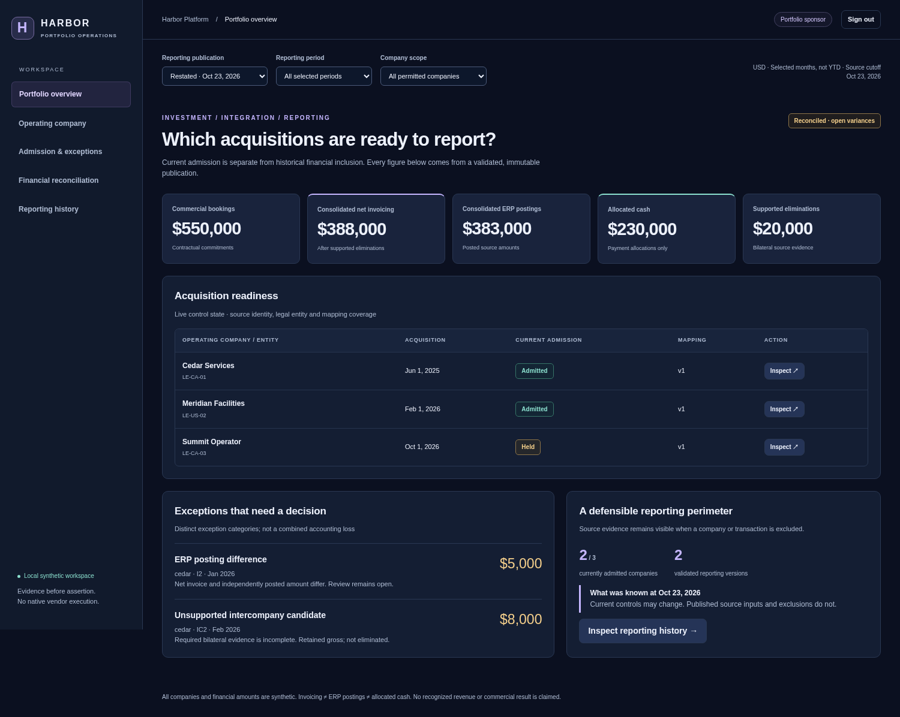

# Executed portable acceptance

The packaged application runs real PostgreSQL, independent loopback HTTP processes, authenticated console actions and dbt builds. It uses synthetic sources and requires no vendor credentials. This is packaging acceptance, not a repeat of the independent Pass 5 audit.

## Recorded results

Both successful records pin implementation commit `09657883afecc989b0ae910cb301a6d0d18a5c15` and its exact source hashes. The later evidence/CI wiring commit does not change application behavior.

| Execution | Result | Inspect |
|---|---|---|
| Actual Docker Compose on GitHub Actions, Engine 28.0.4 | Normal image startup, host login, graceful shutdown, fresh restart, old credentials/session rejection and separate browser-image acceptance passed | [Execution record](compose-run01/portable.json), [browser observations](compose-run01/browser/browser.json), [artifact hashes](compose-run01/artifact-integrity.json), [executed workflow](https://github.com/rlbsem/enterprise-acquisition-onboarding/actions/runs/40357114784) |
| Windows native PostgreSQL/HTTP fallback | Same startup/restart and browser acceptance passed; does not establish container isolation on Windows | [Execution record](native-run01/portable.json), [browser observations](native-run01/browser/browser.json), [artifact hashes](native-run01/artifact-integrity.json) |
| First Docker trial, preserved failure | Container became healthy, but host publication on an internal-only network was unreachable. Owned containers, networks and volumes were independently absent after teardown | [Original failed record](failed-network-run01/portable.json), [artifact hashes](failed-network-run01/artifact-integrity.json), [failed workflow](https://github.com/rlbsem/enterprise-acquisition-onboarding/actions/runs/40353754906) |

Each successful browser run records **53 passing observations, seven genuine Chromium screenshots and seven axe accessibility views**, with no violations or unresolved checks. Tests exercise sponsor/company scope, rejected foreign access, CSRF/origin controls, reviewer reject/approve decisions, actor-bound audit, session expiry/logout and mobile rendering. The seeded independent receiver retains exactly one effect and one business POST throughout browser use.

Both original and restated publications execute nine dbt models and nine data tests. Seven independent model comparisons per publication have zero row differences. Synthetic consolidated net invoicing changes from USD $368,000 to $388,000; allocated cash stays $230,000 and supported eliminations $20,000. The $5,000 ERP posting difference and $8,000 unresolved intercompany candidate remain visible. The unbalanced candidate cannot publish, and the original report remains unchanged.

The full local regression at the same revision passed **74 tests, zero failures/errors/skips**, plus all four standalone demos. [GitHub regression acceptance](https://github.com/rlbsem/enterprise-acquisition-onboarding/actions/runs/40357114778) also passed. The first follow-up Compose execution completed, but its independent checker used an incorrect financial field name; [that failed check remains visible](https://github.com/rlbsem/enterprise-acquisition-onboarding/actions/runs/40355992326). The successful record above follows that correction and a Windows rejected-request-body handling fix.

## Genuine packaged screenshots

These images are unedited `page.screenshot` captures from Chromium inside the acceptance container. Browser records identify route, viewport, role, publication and image hashes.



[Financial reconciliation](compose-run01/browser/financial-desktop.png) · [Historical publications](compose-run01/browser/history-desktop.png) · [Scoped company](compose-run01/browser/company-desktop.png) · [Governed decisions and audit](compose-run01/browser/governance-desktop.png) · [Mobile portfolio](compose-run01/browser/portfolio-mobile.png) · [Mobile finance](compose-run01/browser/financial-mobile.png)

## Verify and reproduce

```text
python scripts/check_portable_evidence.py docs/evidence/portable/compose-run01
python scripts/check_portable_evidence.py docs/evidence/portable/native-run01
python scripts/check_portable_evidence.py docs/evidence/portable/failed-network-run01 --failed
python scripts/verify_portable.py --workspace .local/portable-review --output .local/portable-review-evidence
python scripts/check_portable_evidence.py .local/portable-review-evidence --working-tree
```

The independent checker validates complete artifact inventories, original hashes, Git source bytes, observed/expected browser checks, financial comparisons and teardown records. CI rechecks these preserved records and performs a fresh Compose execution. Branch CI runs on pull requests; main runs on push, avoiding duplicate jobs canceling one another.

Only the console is published on host loopback. Restricted SQL roles and two separate databases remain intact. This is one trusted local container, with no outbound network firewall, production SSO/TLS, native vendor execution or commercial outcomes. Runtime files and credentials are excluded. [Launch instructions and security boundaries](../../portable-demo.md).
