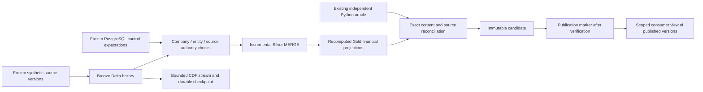

# Native lakehouse acceptance ledger

The owner authorized an overall USD300 resource-consumption envelope, starting
with a native pilot targeting no more than USD20. No account upgrade, external
AWS infrastructure or recurring workload is permitted.

The first pilot uses the existing three-company `Portfolio` fixture and its
independent `portfolio_oracle.calculate` implementation. Admission uses the
fixture's frozen expected control state. This is not an extraction from a running
PostgreSQL deployment or a replacement for its authorization. Existing financial definitions and fixtures are
unchanged. All monetary values are integer USD minor units.



Gold is recomputed from validated Silver. Incremental claims apply to source
history, Silver MERGE and the bounded CDF consumer; this is not a fully incremental
Gold financial engine. Company isolation uses a scoped view with base-table
access denied to the dedicated consumer, not a claim of base-table row filters
or production SSO. The reproducible local application and offline evidence
checks require no Databricks credentials.

## Pilot contract

- One isolated `workspace.acq_lh_*` schema, comment-bound to the fixture hash.
- Disable predictive optimization before creating managed tables.
- Serverless Spark notebook task, bounded timeout and explicit retry controls;
  separate bounded observer/cleanup tasks. No SQL warehouse start or schedule.
- Bronze Delta history, same-revision content conflict protection, replay and
  reordered-input checks, late corrections, cutoff-specific Silver/Gold SQL.
- Compare every company/period and all nine financial metrics, including open
  variances, against independently calculated expected results.
- Commit a candidate, withhold its publication marker, and preserve the earlier
  publication. A subsequent recovery must compare committed content before
  publishing once. Delta table transactions are not cross-table atomicity.
- Record CDF and actual table-version time travel.

Using the previously observed USD0.35/DBU price and an assumed 50 DBU/hour,
1,200 compute-seconds plus a USD2 storage/pending-usage reserve project USD7.84
rounded upward. This is a planning estimate, not a provider-enforced cap or
observed consumption. Cancel/pause if actual or delayed exposure threatens the
USD20 pilot or USD300 overall allowance. Retained storage may be billed after
namespace deletion; cleanup and billing clearance are separate observations.

## Expansion gates

Native pilot success is required before recovery, governance and scale tasks.
Next verify durable CDF checkpoint replay, independent publication readback,
separately executed restricted-principal access, lineage and actual usage.
Only then measure larger distributed synthetic datasets. Each execution uses
finite inputs and a timeout. Current submissions disable both explicit retries
and serverless auto-optimization retries. Failed observations are retained;
there is no unlimited full-run retry. Preserve budget headroom for export and
cleanup before the approved execution window ends.

## Reproduction

The existing protected CLI OAuth profiles are used. No credentials are embedded
in notebooks, fixtures, evidence or source. Private configuration and runtime
logs remain under ignored `.local/`.

```text
python scripts/lakehouse_native.py prepare --config <private-config> --work .local/<fresh-run> --schema acq_lh_<unique-id>
python scripts/lakehouse_native.py upload --config <private-config> --work .local/<run>
python scripts/lakehouse_native.py submit --phase pilot --config <private-config> --work .local/<run>
python scripts/lakehouse_native.py observe --run-id <returned-id> --config <private-config> --work .local/<run>
```

Source must be committed before preparation. The manifest binds the source SHA,
fixture hash and uploaded notebook hash; one-time Jobs submissions use stable
idempotency tokens. Observe an existing run rather than resubmitting to poll it.
Before cleanup, export results and table history. Cleanup verifies the exact
fixture ownership comment before dropping only that schema. Remove the exact
run's notebook and dedicated principal/job, then verify absence separately.

## Executed checkpoint

Actual native results are preserved in the [evidence directory](evidence/lakehouse-native/2026-11-14/README.md).

| Execution | Actual result |
|---|---|
| Initial pilot `376042101469046` | Failed on the default Python 3.10 runtime's unsupported `datetime.UTC` import, before table creation code. Original failure retained. |
| Corrected pilot `165257131529869` | Passed on Spark 4.2.0/Python 3.10.12; 162 original source rows plus three corrections; all nine financial metrics at company/period and portfolio grains matched the existing independent oracle. |
| Incremental and historical state | Silver MERGE matched independent full-snapshot results; duplicate/reordered delivery did not change source membership; earlier Delta table-version readback matched the baseline. |
| Publication boundary | Original publication remained visible while the corrected candidate was committed but deliberately unpublished. This first pilot withheld a marker; it did not crash a process. |
| First observer `365544213277342` | Timed out with a five-minute total allowance after 236 seconds of setup. No successful readback is attributed to this record. |
| Corrected observer `1066881425859697` | Passed; original publication independently read back and reconciled, actual history observed and 66 native lineage records returned. These are records, not 66 distinct dependencies. |

The corrected pilot took 135 seconds to set up and 238 seconds to execute.
The successful observer took 266 seconds to set up and 194 seconds to execute.
These are acceptance-task durations including checks, not ingestion throughput
benchmarks. Immutable records retain exact source commits; later fixes do not
retroactively change what an older run proved.

Usage reads returned no rows. This is pending reporting, not zero consumption.
The first native rate query also returned no rows because its SKU pattern
assumed the words SERVERLESS and JOBS were in the wrong order. The corrected
query subsequently confirmed Premium Oregon Jobs at USD0.35/DBU in the native
price table. Actual workload quantities and billing remain unverified.

Databricks documents [up to a 24-hour reporting delay](https://docs.databricks.com/aws/en/compute/serverless),
and [new-workspace delivery can take longer](https://docs.databricks.com/aws/en/admin/system-tables/billing).
Completed-run wall time is reserved at 75 DBU/hour times USD0.35 (a conservative
50 DBU/hour scenario assumption plus a 50% margin). Those padded pending
estimates are not billed amounts. Future task timeouts remain reserved and a
separate cleanup/storage reserve is retained. Scale expansion stays blocked
until actual usage, applicable rates and successful pilot acceptance are observed.

## Recovery, authorization and final state

The [bounded Jobs chain](evidence/lakehouse-native/2026-11-14/05-recovery-chain-failure.json)
recorded a real task failure after a durable Delta journal commit. Recovery
published the corrected version, but its later constraint probe used unsupported
SQL syntax. That failed job is retained as **failed**. Serverless auto-optimization
also generated additional attempts despite `max_retries=0`; subsequent submissions
explicitly set `disable_auto_optimization=true`. See the [provider retry behavior](https://docs.databricks.com/aws/en/jobs/run-serverless-jobs).

The [successful continuation](evidence/lakehouse-native/2026-11-14/06-postcheck.json)
reconciled both existing publications and independently reproduced the corrected
source-membership hash before continuing. It did not republish financial effects.
Conflicting replay and wrong-entity/source inputs were rejected. The corrected
probe produced `DELTA_VIOLATE_CONSTRAINT_WITH_VALUES`, with no partial write.
The CDF consumer processed 165 records and, after restart from its durable
checkpoint, retained the same 165 rows. This is a bounded checkpoint/replay test,
not a claim that Gold is continuously streamed.

The [restricted-consumer run](evidence/lakehouse-native/2026-11-14/08-restricted-consumer.json)
used an actual separate service principal. Its executing identity fingerprint
matched the created test identity. Four approved company/period/publication
rows matched the independent oracle. Direct Bronze reads and publication writes
returned `INSUFFICIENT_PERMISSIONS`; schema creation returned `UNAUTHORIZED_ACCESS`.
The initial workspace-access failure is retained separately. The deployer received
only the use role on this new principal, and only that principal received the
basic workspace-access entitlement; existing grants were preserved.

These are known-fixture Unity Catalog data-plane conformance tests. The harness
contains public synthetic expectations and is not a production confidentiality,
SSO or complete workspace-security assessment. Producer privilege remains trusted.

The [final SQL audit](evidence/lakehouse-native/2026-11-14/09-financial-sql-audit.json)
executed the final shared bilateral SQL on Spark, reconciled the corrected
financial snapshot and confirmed unchanged publications. Offset-aware timestamp
comparison also passed. The same SQL additionally passed local SQLite comparisons
against the 50-company independent oracle, including unmatched extra charge and
acceptance cases. Those 50-company tests are **local**, not native Spark results.

All nine uploaded source assets matched independent API readbacks before retirement.
The owned schema (11 managed tables, one view and one managed checkpoint volume),
both run notebook directories and the dedicated identity were retired.
[Fresh management-only inventory](evidence/lakehouse-native/2026-11-14/post-teardown.json)
confirmed logical absence, nine terminal parent runs, no active/saved owned jobs,
and the pre-existing warehouse still stopped. Workspace identity removal alone
left the account identity discoverable; exact account-level deletion was completed
and both inventories then confirmed absence. No extra compute was started for cleanup.

Physical storage expiry and final billing are not cleared by logical deletion.
The [cost observation](evidence/lakehouse-native/2026-11-14/cost-observation.json)
keeps actual billed cost and DBUs unknown, padded pending estimates separate,
and the preserved interoperability failures in the bounded controlled-rerun reserve.

**Remaining native milestone:** run the full 50-company financial lane and the
prepared distributed scale probe after actual consumption is observable. The
probe measures Delta writes and grouped financial arithmetic at 100K/1M rows;
it is not a benchmark of all financial transformations. No native scale timing,
throughput, DBU quantity or production reliability is claimed here.
